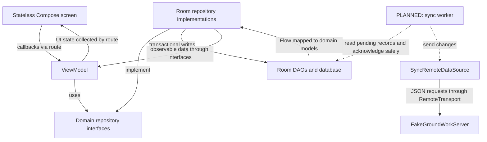

# GroundWork

[](https://github.com/naz-io/ground-work/actions/workflows/android-ci.yml?query=branch%3Amain+event%3Apush)

GroundWork is an offline-first Android app for field teams working with unreliable connectivity. Capture field notes immediately, optionally associate them with sites, and keep local work available without a network connection.

The project explores reliable local persistence, explicit UI state, and the data-integrity rules needed before adding sync.

## Current state

| Available now | Next | Later |
| --- | --- | --- |
| Field notes and sites: create, edit, delete, search, and filter | Sync worker connecting pending records to the simulated backend | Conflict detection and resolution |
| Optional site assignment, Site Detail, and unassigned capture | Protect local edits made during an upload | Attachments and evidence |
| Room persistence, migrations, transactional writes, and sync metadata | Manual retry and sync status UI | Dashboard and measured performance work |
| Typed navigation with a back stack per tab and saved editor drafts | | |
| Simulated JSON backend and tests for its contract | | |

**Sync is not connected yet:** local writes record pending changes, but no worker uploads them. The simulated server is in memory and resets with the process. See the [scope and roadmap](docs/roadmap.md).

## Architecture at a glance

Solid arrows show existing calls, state flow, or implementation relationships; the dotted arrows describe the planned worker connections.



Room is the local source of truth. ViewModels depend on domain repository interfaces; data-layer implementations map Room entities to domain models. The remote source exists independently of the local save path.

[Save sequence and sync lifecycle diagrams](docs/architecture.md) · [Quick recall guide](docs/quick-recall.md)

## Engineering decisions

| Problem | Decision and tradeoff | Implementation and evidence |
| --- | --- | --- |
| A local delete may still need to reach a server | Keep previously synced rows as hidden pending deletes; remove unsynced creates outright. Queries must distinguish visible rows from sync records. | [Repository](app/src/main/java/com/nabadi/groundwork/data/repository/OfflineFirstFieldNoteRepository.kt) · [Repository tests](app/src/androidTest/java/com/nabadi/groundwork/data/repository/OfflineFirstFieldNoteRepositoryTest.kt) |
| Soft-deleting a site does not trigger a foreign key action | Explicitly unassign its visible notes in the same transaction and update their sync metadata. This adds repository logic. | [Site repository](app/src/main/java/com/nabadi/groundwork/data/repository/OfflineFirstSiteRepository.kt) · [Site deletion tests](app/src/androidTest/java/com/nabadi/groundwork/data/repository/OfflineFirstSiteRepositoryTest.kt) |
| Saves must respect the record's latest sync state | Read and write within a Room transaction; reject edits to deleted records. Network acknowledgments will need a separate concurrency guard. | [Sync rules](app/src/main/java/com/nabadi/groundwork/domain/model/SyncMetadata.kt) · [Transition tests](app/src/test/java/com/nabadi/groundwork/domain/model/SyncMetadataTest.kt) |
| Cancellation must not look like a failed save | Rethrow cancellation and catch ordinary exceptions in a shared helper. Editors map ordinary failures to operation-specific UI errors. | [Helper](app/src/main/java/com/nabadi/groundwork/core/common/SuspendRunCatching.kt) · [Cancellation tests](app/src/test/java/com/nabadi/groundwork/core/common/SuspendRunCatchingTest.kt) |
| Switching tabs should preserve each navigation history | Keep one back stack per tab and centralize changes in Navigator. This requires explicit back behavior. | [Navigator](app/src/main/java/com/nabadi/groundwork/navigation/Navigator.kt) · [Navigation tests](app/src/test/java/com/nabadi/groundwork/navigation/NavigatorTest.kt) |
| Time and generated IDs make assertions unpredictable | Inject Clock and IdGenerator. More constructor dependencies buy exact, repeatable assertions. | [Editor ViewModel](app/src/main/java/com/nabadi/groundwork/feature/fieldnotes/editor/FieldNoteEditorViewModel.kt) · [Editor tests](app/src/test/java/com/nabadi/groundwork/feature/fieldnotes/editor/FieldNoteEditorViewModelTest.kt) |
| A fake backend can hide integration mistakes | Give it a separate JSON contract, validation, and failure simulation. It adds mapping code and has no durable server storage. | [Remote source](app/src/main/java/com/nabadi/groundwork/data/remote/SyncRemoteDataSource.kt) · [Wire-format tests](app/src/test/java/com/nabadi/groundwork/data/remote/RemoteWireFormatTest.kt) |

[Detailed rationale and tradeoffs](docs/architecture.md#architecture-decisions)

## Tech stack

Kotlin, Jetpack Compose / Material 3, Navigation 3, Hilt, Room, Coroutines / Flow, and kotlinx.serialization. Tests use JUnit 4, Turbine, coroutine test utilities, Room testing, and Compose UI testing.

The app is a single Gradle module organized by feature and layer. Exact dependency versions are in the [version catalog](gradle/libs.versions.toml); Android SDK and release shrinking settings are in the [app build configuration](app/build.gradle.kts).

## Build and test

Use JDK 21 for Gradle and an Android SDK matching the app configuration (compile SDK 37.2, minimum device API 30). Configure the SDK path through Android Studio or your local Android SDK setup. The wrapper pins the Gradle version.

```sh
./gradlew assembleDebug
./gradlew testDebugUnitTest
# Start an emulator or connect a device first:
./gradlew connectedDebugAndroidTest
# Additional local checks:
./gradlew lintDebug assembleRelease
```

[Android CI](.github/workflows/android-ci.yml) runs unit tests and a debug build, then instrumented tests on an API 30 emulator. It runs on pushes to `main` and pull requests; the badge links to `main` push results. Release builds and lint are additional local checks, not jobs in this workflow.

[Testing guide and coverage map](docs/testing.md)

## Project guide

- [Quick recall](docs/quick-recall.md): what was built, why, tricky cases, and code/test entry points.
- [Architecture](docs/architecture.md): save sequence, sync lifecycle, and design tradeoffs.
- [Testing](docs/testing.md): unit and instrumented coverage, CI, and planned tests.
- [Scope and roadmap](docs/roadmap.md): current boundaries and future work.
- [Version history](docs/history.md): milestones from setup through the sync groundwork.
