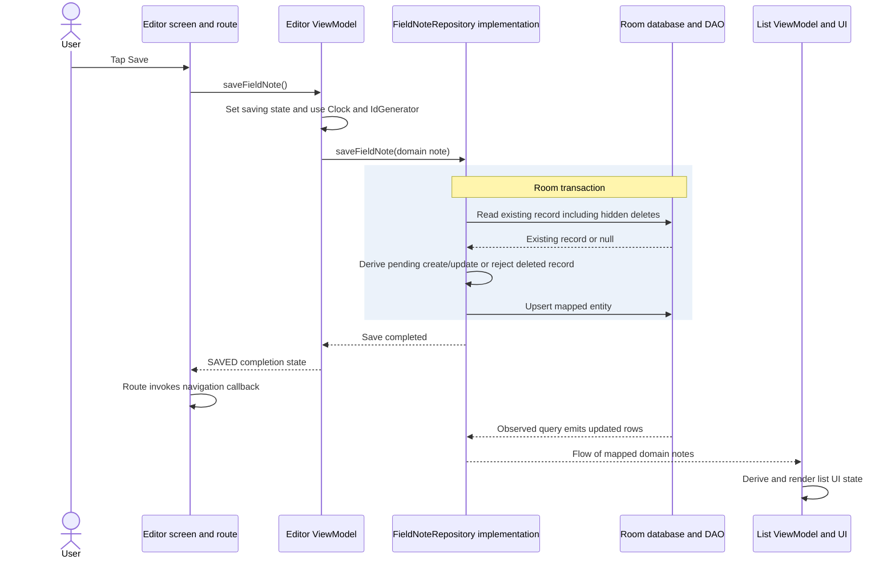
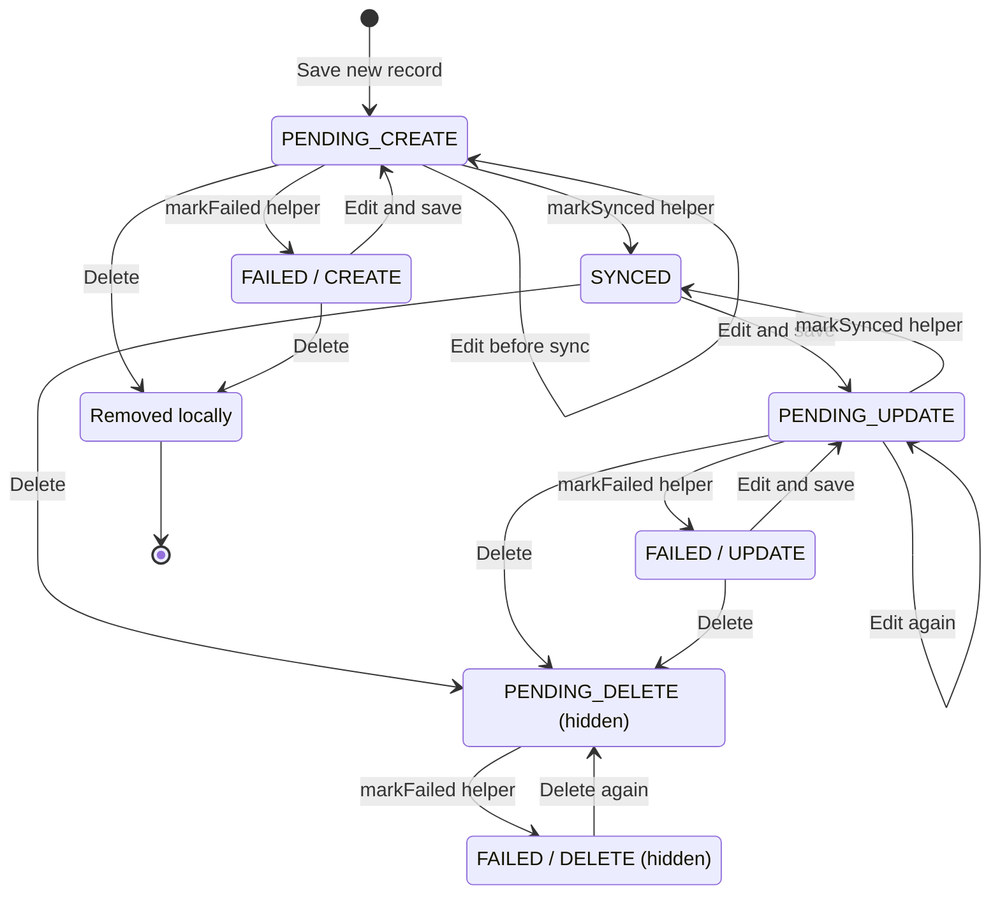

# GroundWork architecture

[README](../README.md) · [Architecture](architecture.md) · [Quick recall](quick-recall.md) · [Testing](testing.md) · [Roadmap](roadmap.md) · [History](history.md)

The app persists local edits in Room before any sync. See the [architecture overview](../README.md#architecture-at-a-glance) for component relationships; the diagrams below explain the save path and sync rules.

## Saving a field note

This is the current local save path. The editor constructs the note, while the repository determines its pending sync operation from the stored record. List observation and editor completion are separate reactions; their relative delivery order is not guaranteed.

On an ordinary save exception, the editor clears its saving state and exposes `SAVE_FAILED`. Cancellation propagates instead of becoming a UI error. There is no remote call in this sequence.

## Sync lifecycle

The diagram combines current repository save/delete behavior with the domain model's failure and acknowledgment helpers. Those helpers are implemented and tested, but no worker calls them to complete uploads yet. The three failed nodes below are one `FAILED` state distinguished by `SyncFailure.operation`.

- Pending or failed deletes remain hidden and reject updates, so saving cannot revive a deleted row.
- Deleting a pending or failed create removes it locally. The repository owns this choice; `markPendingDelete()` alone does not remove database rows.
- Deleting a site explicitly unassigns visible notes, updates their timestamps, and applies `markPendingUpdate()` to each within the same transaction. An unsynced note remains a pending create.
- The diagram shows intended create/update acknowledgment use. `markSynced()` itself is an unguarded metadata helper; it neither checks for a newer local edit nor removes a deleted row.
- **Still planned:** upload processing, explicit retry orchestration, safe acknowledgments after concurrent local edits, and cleanup after a successful remote delete. No automatic retry or remote-delete completion is implied by this diagram.

## Architecture Decisions

### Local-first foundation

The app starts with local persistence before any remote sync. This keeps the first version focused on reliable state and data flow instead of prematurely introducing backend complexity.

### Domain-first modeling

The app starts with a small domain model before introducing Room or UI implementation details. `FieldNote`, `FieldNoteId`, `FieldNoteStatus`, `Site`, `SiteId`, `SiteStatus`, and `SitePriority` describe the core app concepts independently of persistence, navigation, or Compose. Repository contracts define how the rest of the app accesses local data without depending directly on the database layer.

### Room as local source of truth

Even before sync exists, Room is treated as the durable source for app data. The UI reads app state through repositories and ViewModels rather than directly from the database.

### Field notes and sites before association

Field notes were implemented first as the smallest useful slice of the larger GroundWork concept. Sites were added next as a separate local foundation, with their own domain model, Room persistence, repository, list/editor UI, and tests.

The relationship between field notes and sites was introduced only after both foundations were stable. The relationship is optional so field notes can belong to a site without sacrificing fast unassigned capture.

### Route and screen separation

Compose screens separate ViewModel-connected routes from stateless screen content. Routes collect ViewModel state, while screens receive state and callbacks. This keeps the screens previewable, easier to test, and independent of Hilt.

### Repository-driven UI state

ViewModels observe repository contracts rather than reading from Room directly. This preserves the architecture boundary between UI and persistence and keeps the future sync implementation behind the repository layer.

### Sync metadata before a sync engine

Every field note and site carries `SyncMetadata` (state, last sync time, and structured failure). Repositories set it on every write, so the local database already knows what needs to be created, updated, or deleted remotely before any sync code exists. The transition rules live on `SyncMetadata` itself and are unit tested, so a future sync worker can reuse those helpers. It must still coordinate upload ordering, guard acknowledgments against newer local edits, and clean up completed deletes.

### Soft deletes

Deleting a record that has already synced marks it `PENDING_DELETE` instead of removing the row, so the delete can still be sent to a server. Records that were never synced are deleted outright. UI-facing DAO queries hide deleted rows through one shared `NOT_DELETED` SQL fragment, which mirrors `SyncMetadata.isDeleted`; `...ForSync` queries still see them. Because a soft-deleted site keeps its row, the site repository unassigns the site's notes explicitly rather than relying on the `ON DELETE SET NULL` foreign key.

### Transactional repository writes

Saves and deletes read the current sync state and then write. Each of these paths runs inside a Room transaction so a future sync worker cannot change the row between the read and the write. Transactions do not cover network calls, so the sync worker will still need its own check before marking a record synced.

### A simulated backend with its own wire format

The sync backend is simulated, but it is treated as a separate system. Remote models use the backend's conventions rather than the domain's or Room's, so the API does not change when a domain field is renamed. Requests go through an HTTP-shaped `RemoteTransport`; the app binds it to `FakeGroundWorkServer` in `RemoteModule`, and a real backend would replace only that binding. The fake parses and stores JSON and enforces the rules a real server would, so wire-format mistakes and wrong sync ordering fail in tests instead of being hidden. `SyncRemoteDataSource` reduces every outcome to success, transient failure, or rejection: network errors, timeouts, rate limits, and server errors are retried, other 4xx responses are not, and an unreadable success response is treated as a server problem rather than a reason to mark local data failed. The fake keeps its data in memory, so it resets when the process dies.

### Type-safe navigation and route-scoped ViewModels

Destinations are `@Serializable` `NavKey` classes under `GroundWorkRoute`, so arguments are checked at compile time and required arguments, such as Site Detail's site ID, cannot be missing. Navigation uses Navigation 3: `NavigationState` holds one back stack per bottom-bar tab, `Navigator` is the only thing that changes it, and `NavDisplay` draws it, so navigation follows the same one-way data flow as screen state. Each entry receives its typed route as its key and passes it to the ViewModel through a Hilt assisted factory, and a ViewModel-store decorator scopes each ViewModel to its entry. ViewModels therefore take a plain route object, which keeps them free of `SavedStateHandle` key lookups and lets local unit tests construct them directly. Editor ViewModels still use `SavedStateHandle` for unsaved drafts; typed route injection replaces argument lookups, not draft persistence.

### Typed UI errors

ViewModels expose per-screen error enums (for example `SiteEditorError.SAVE_FAILED`) instead of display strings. Each error carries its string resource, and screens resolve the text with `stringResource`. This keeps user-facing text in string resources, ready for translation, and lets tests assert on error values rather than English sentences.

### Coroutine failures without swallowing cancellation

Editor ViewModels run saves, deletes, and loads in `viewModelScope` and turn any failure into a typed UI error. They used `runCatching` for this, but `runCatching` catches every `Throwable`, including the `CancellationException` that coroutines use to cancel work. A cancelled save, for example when the ViewModel is cleared, was then reported as a failed save, and cancellation stopped propagating, breaking [structured concurrency](https://kotlinlang.org/docs/cancellation-and-timeouts.html). Android's [coroutines best practices](https://developer.android.com/kotlin/coroutines/coroutines-best-practices) say not to consume `CancellationException` and to prefer catching specific exception types.

Catching only specific types was considered and rejected for now: repositories fail in several ways (SQLite errors from Room, the `IllegalStateException` for saving a deleted record, and soon sync failures), and any type left off the list would crash the app instead of showing the typed error. Instead, failable work goes through `suspendRunCatching`, which rethrows `CancellationException`, catches `Exception` rather than `Throwable` so errors such as `OutOfMemoryError` aren't swallowed, and otherwise behaves like `runCatching`. It is the same helper Google's Now in Android sample uses for sync ([`SyncUtilities.kt`](https://github.com/android/nowinandroid/blob/main/core/data/src/main/kotlin/com/google/samples/apps/nowinandroid/core/data/SyncUtilities.kt)). Now in Android keeps it private next to its only caller; here two features already use it and the sync layer will too, so it lives in `core/common`, the single-module counterpart of the [common (core) module](https://developer.android.com/topic/modularization/patterns#common-modules) in Android's modularization guidance. `SuspendRunCatchingTest` pins the behavior.

### Injected time and IDs

Editor ViewModels receive a `java.time.Clock` and an `IdGenerator` from Hilt instead of calling `System.currentTimeMillis()` and `UUID.randomUUID()` directly. Tests use a fixed clock and a predictable ID, which matters for upcoming sync and conflict logic that depends on timestamps.

### ViewModel-level search and filtering

Search and filtering currently run in list ViewModels over observed local data. This keeps the first implementation simple, testable, and easy to combine with UI state. DAO-backed search or Room FTS can be introduced later if larger datasets make in-memory filtering inappropriate.

### Testable local foundation before sync

Domain, migration, DAO, repository, ViewModel, UI state, and Compose tests were in place before the sync simulation begins, so sync can be added against a well-covered local layer.

## Tradeoffs

### Delaying sync

Sync is a major part of the long-term app direction, but it was intentionally delayed until the local source of truth, repository boundary, and UI state flow were correct. It is now being added in layers: sync metadata, soft deletes, and transactional writes first, so the sync worker, retries, and conflict handling can build on a local model that already knows what has changed.

### Sequencing field note/site association

Sites were implemented as their own local foundation before the relationship between sites and field notes was added in v0.8.0. This kept v0.7.0 focused on validating the Sites model, persistence, list/editor UI, navigation, and tests before adding cross-feature behavior.

### Avoiding premature modularization

The project starts with a simple feature-oriented package structure instead of a large multi-module setup. Additional modules will be introduced only when shared code or build boundaries justify them. The first shared package, `core/common`, holds small helpers used by more than one layer or feature (currently `suspendRunCatching`), mirroring the common (core) module in Android's [modularization guidance](https://developer.android.com/topic/modularization/patterns#common-modules) so it can become a module if the app is split later. A helper stays private next to its caller until a second one needs it.

### Repository contracts in the domain layer

The Android architecture guide places repositories in the [data layer](https://developer.android.com/topic/architecture/data-layer) and reserves the optional [domain layer](https://developer.android.com/topic/architecture/domain-layer) for use cases, with the domain layer depending on data. GroundWork inverts that dependency: repository interfaces live in `domain` next to the models and `SyncMetadata`, and `data` provides the Room-backed `OfflineFirst*Repository` implementations. Dependencies point inward, so ViewModels see only domain types and never Room, and the fakes and the coming sync engine sit behind the same contracts. There are no use cases yet because no business logic is shared across ViewModels; they will be added to `domain` when sync or conflict handling produces logic that several screens need.
